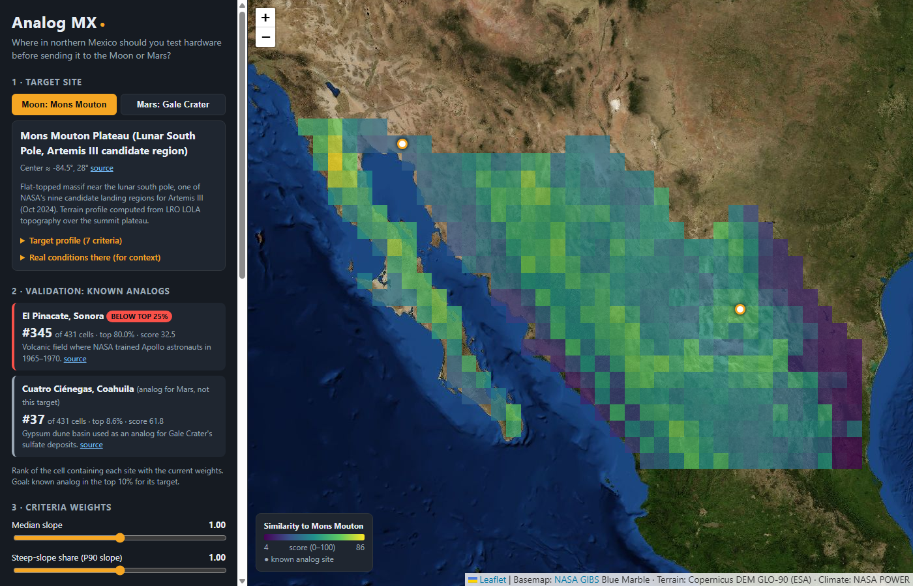
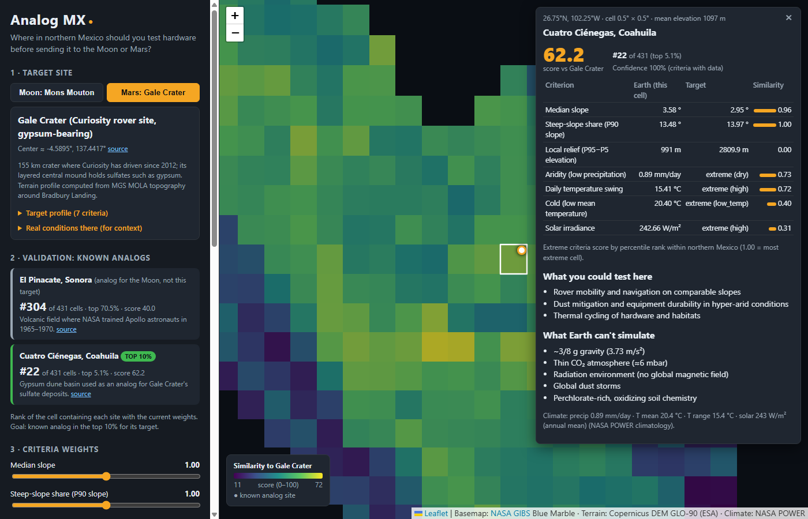

# Analog MX

**Where in northern Mexico should you test hardware before sending it to the Moon or Mars?**

Analog MX scores every 0.5° cell of northern Mexico against the terrain and climate profile of a target site — the **Mons Mouton Plateau** (lunar south pole, Artemis III candidate region) or **Gale Crater** (Curiosity's site on Mars) — and ranks the best places on Earth to test rovers, habitats and instruments there first. Built for the NASA Space Apps Challenge 2026 challenge *"Identify Earth Locations that Analog the Permanent Moon Base Locations and Mars"*.

🌐 **Live site:** _(GitHub Pages URL — see below)_




## What it does

1. Pick a target (Moon: Mons Mouton / Mars: Gale) and see its profile — every value links to its source.
2. A heat map of northern Mexico shows a 0–100 similarity score per cell.
3. Weight sliders recompute the map and ranking instantly in the browser.
4. A top-10 list shows the best candidate cells.
5. **Validation:** where two known analogs — El Pinacate (Apollo training site) and Cuatro Ciénegas (gypsum analog for Gale) — land in the ranking.
6. Click any cell to see its score, per-criterion breakdown, **"What you could test here"** and **"What Earth can't simulate"**.

## Data

| Dataset | Agency | Used for |
|---|---|---|
| [NASA POWER](https://power.larc.nasa.gov/) climatology API (regional, `community=SB`) | NASA | Annual means: temperature (`T2M`), daily range (`T2M_RANGE`), precipitation (`PRECTOTCORR`), all-sky surface irradiance (`ALLSKY_SFC_SW_DWN`, W/m²) |
| [NASA GIBS](https://www.earthdata.nasa.gov/engage/open-data-services-software/earthdata-developer-portal/gibs-api) WMTS `BlueMarble_ShadedRelief_Bathymetry` | NASA | Basemap |
| [LRO LOLA DEM 118 m](https://astrogeology.usgs.gov/search/map/moon_lro_lola_dem_118m) (USGS Astrogeology mosaic) | NASA / USGS | Terrain profile of the Mons Mouton Plateau |
| [MGS MOLA DEM 463 m](https://astrogeology.usgs.gov/search/map/mars_mgs_mola_dem_463m) (USGS Astrogeology mosaic) | NASA / USGS | Terrain profile of Gale Crater (around Bradbury Landing) |
| [Copernicus DEM GLO-90](https://registry.opendata.aws/copernicus-dem/) (AWS Open Data COGs) | ESA | Terrain of every Earth cell |
| [Natural Earth](https://www.naturalearthdata.com/) admin-0 countries | — | Clip the grid to Mexico |
| NASA fact sheets, LRO Diviner (Paige et al. 2010), Curiosity REMS, NASA Earth Observatory | NASA | Context values in the target cards (linked in the UI) |

Copernicus DEM was used because NASA Earthdata (needed for SRTM/NASADEM) was in maintenance during the hackathon.

**Attribution:** produced using Copernicus WorldDEM-90 © DLR e.V. 2010-2014 and © Airbus Defence and Space GmbH 2014-2018 provided under COPERNICUS by the European Union and ESA; all rights reserved.

**Notes on POWER parameters:** all seven requested parameters (`T2M, T2M_MAX, T2M_MIN, T2M_RANGE, PRECTOTCORR, ALLSKY_SFC_SW_DWN, RH2M`) exist in the climatology. Meteorological parameters come on POWER's 0.5° × 0.625° grid and solar on a 1° grid, so each Analog MX cell takes the value of the nearest POWER grid point for each parameter.

## Scoring method

Cells: regular 0.5° × 0.5° grid, 22–33°N, 117–98°W, centre inside Mexico → **431 cells**.

Cell score: `S = 100 · Σ wᵢ·sᵢ / Σ wᵢ` over criteria with data. Confidence = share of criteria with data.

- **Terrain ("match") criteria** — median slope, 90th-percentile slope, local relief (P95−P5 elevation). Computed on ~460 m pixels for Earth (Copernicus GLO-90), the Moon (LOLA) and Mars (MOLA) with the **same code path**, so the numbers are comparable. `sᵢ = exp(−½((xᵢ − tᵢ)/σᵢ)²)`, with σᵢ = IQR across all cells / 1.349.
- **Climate ("extreme") criteria** — the Moon and Mars are far outside Earth's range, so these score by percentile rank within the region toward the extreme: aridity (lowest precipitation), daily thermal range (highest), cold (lowest mean temperature), solar irradiance (highest).
- **Default weights:** each terrain criterion 1.0, aridity 1.0, thermal range 0.75, cold 0.5, solar 0.5.

Target terrain values (from `pipeline/target_terrain.py`, 40 km N-S × 30 km E-W box):

| Target | Box centre | Median slope | P90 slope | Relief P95−P5 |
|---|---|---|---|---|
| Mons Mouton Plateau (LOLA) | 84.5°S, 28.0°E (summit plateau) | 5.91° | 13.1° | 1,531 m |
| Gale Crater (MOLA) | 4.5895°S, 137.4417°E (Bradbury Landing) | 2.95° | 13.97° | 2,810 m |

## Validation (default weights)

| Known analog | Expected target | Cell | Rank | Percentile |
|---|---|---|---|---|
| **Cuatro Ciénegas, Coahuila** | Mars (Gale) | 26.75°N, 102.25°W | **22 / 431** | **top 5.1 %** ✅ |
| **El Pinacate, Sonora** | Moon (Mons Mouton) | 31.75°N, 113.25°W | 345 / 431 | top 80 % ❌ |

**Cuatro Ciénegas** passes: its slopes match Gale closely (similarity 0.96 and 1.00), and it is among the most arid cells with large daily temperature swings.

**El Pinacate does not pass, and we did not force it.** Criterion directions were checked and no weights were tuned. The reason is physical. The Pinacate cell is a low, gentle volcanic plain (median slope 0.6°, relief 330 m, mean elevation 230 m). The Mons Mouton Plateau is a highland massif (median slope 5.9°, relief ≈1.5 km in LOLA). Apollo astronauts trained at Pinacate for **volcanic geology and crater fieldwork** relevant to the equatorial maria. That is a different kind of analog from the rugged south-polar highlands Artemis is targeting. Pinacate still scores high on aridity (0.90) and solar irradiance (0.84). The top Moon candidates are mountainous, very dry cells in the Sierra San Pedro Mártir area of Baja California (31.25°N, 115.75°W, score 85.6).

Reproduce with `python pipeline/validate.py`, which runs the same `web/score.js` the browser uses.

## Run it

```bash
pip install -r requirements.txt
python pipeline/fetch_power.py      # NASA POWER, cached in data/raw/power (≈105 requests, ~5 min)
python pipeline/fetch_dem.py        # Copernicus GLO-90 tiles at ~460 m, cached in data/raw/dem
python pipeline/target_terrain.py   # LOLA / MOLA target terrain -> data/target_terrain.json
python pipeline/build_cells.py      # -> web/cells.json (+ copies targets / known sites)
python pipeline/validate.py         # rank + percentile of the known analogs (needs Node.js)
python -m http.server 8000 --directory web
```

Deep links: `index.html#mars_gale/26.9,-102.1` opens a target with a cell selected.

## Limitations

- 0.5° cells (~55 km) average out local features: the gypsum dunes of Cuatro Ciénegas or individual Pinacate maars are far smaller than a cell.
- Target terrain uses one 40 × 30 km box; the result depends on where that box sits (the Gale box includes part of the crater's north wall, hence its large relief).
- Slopes depend on the DEM resolution. Earth, Moon and Mars are all compared at ~460 m, so metre-scale roughness (rocks, boulders) that matters for rovers is not captured.
- Climate criteria are relative (percentiles inside northern Mexico); no place on Earth reaches lunar or Martian temperatures.
- No mineralogy yet (e.g. gypsum/sulfates from EMIT), which would matter for Gale.
- **What Earth can't simulate:** gravity (1/6 g Moon, ~3/8 g Mars), vacuum or thin CO₂ atmosphere, radiation, low-angle polar light and permanently shadowed regions, global dust storms.

## Credits

Built for the NASA Space Apps Challenge 2026. Code written with the help of Claude Code (AI coding assistant), reviewed by the team. Data from NASA (POWER, GIBS, LRO LOLA, MGS MOLA), ESA/Copernicus (GLO-90), USGS Astrogeology and Natural Earth. Analog MX is not affiliated with or endorsed by NASA or ESA.
